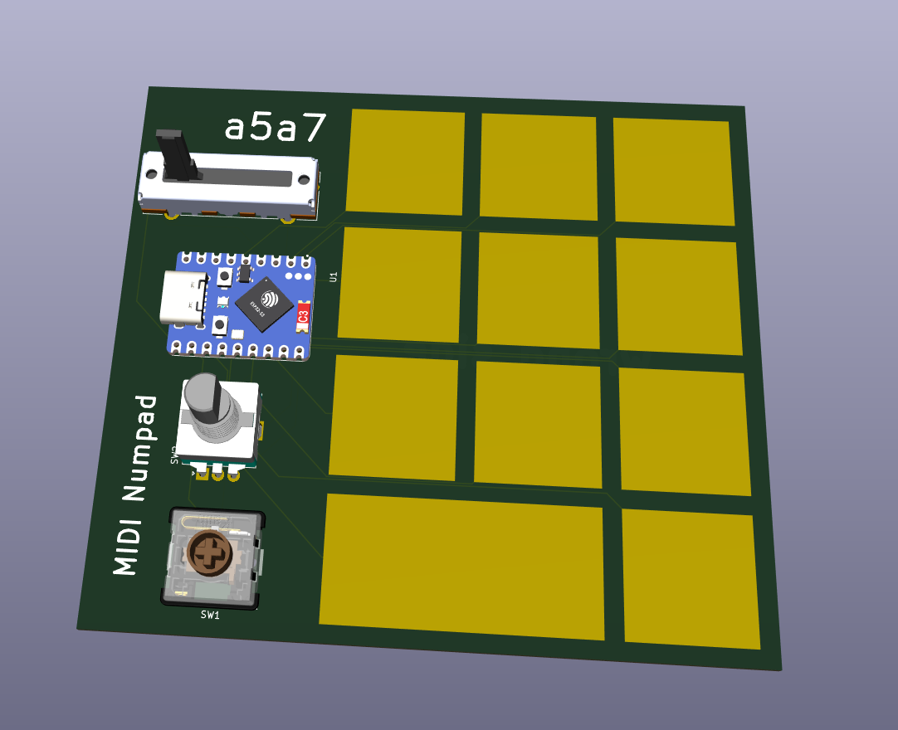
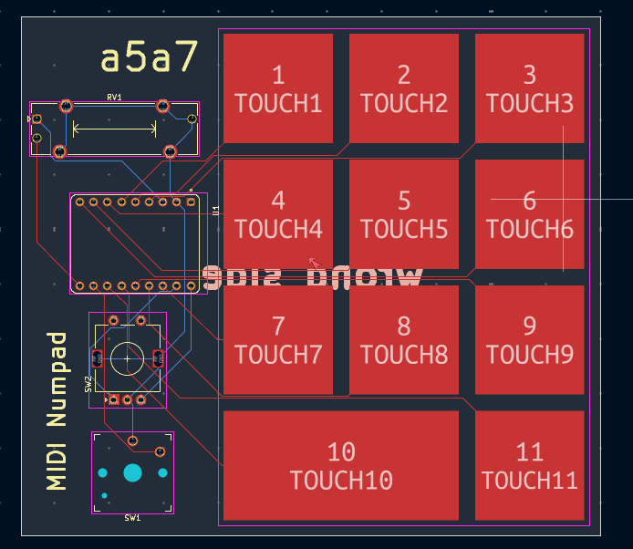

# MIDI Numpad

(All the files say keyboard because that was the original idea...)

I miscounted the number of keys in a single scale (12) as 11. Thus, this is now a numpad. It has a rotary encoder (something I'm going to use to adjust the pitch) and a potentiometer (which is going to adjust volume). It'll be fun to see how different numbers sound. 

## Final PCB Design

The routing went much better compared to last time. I actually finally understood how to use the bottom layer, which was incredibly helpful to making it better (I also experimented a lot more with the schematic to rearrange things to make things nicer). 

The schematic and PCB are all in this repository. 